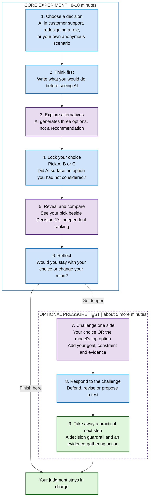

# The Decision Room: your experiment journey

**AI does not make the call. You do.**

Start with your own judgment, compare it with AI, then decide what deserves a second look.

**What to watch for:** Did AI expand your options? Did its ranking influence you? What evidence would justify changing your mind?

**Why this order matters:** You commit before seeing AI-generated options, and choose before seeing the model's ranking. Your selected option is not included in the independent scoring request. A model score is input to your judgment, not a verdict.

## After the live experiment

### Local rubric and context preview

Before ranking, attendees can choose **Workshop balance**, **People & caution**, or
**Impact & speed**, edit the weights, or switch to custom mode to edit, add or
remove criteria. Both built-in and custom scenarios use these controls. A valid
rubric has 2-8 distinct criteria with definitions, whole-number weights totaling
100%, and at least two positive weights. A completed journey cannot be rescored
with a changed rubric; start another journey instead.

The final **Inside this decision** panel shows the original session scenario,
the exact generated A/B/C options, the backend-confirmed rubric definitions and
weights, and scoring instructions. The private written answer and selected
option are excluded from Decision-1 input; the comparison agent does receive the
written answer. No external datasource is connected by this feature.

Weights guide the model's judgment, not an application-calculated weighted sum.
Option probabilities are not forecasts of business success, and the panel is
an input receipt rather than a model rationale. In mock mode it explicitly
labels the prepared inputs and fixed scores as simulated.

Run `npm run dev --prefix server` and `npm run dev --prefix client` in separate
PowerShell terminals, then visit the Vite localhost URL. Development defaults to
mock mode. Live mode needs `MODEL_PROVIDER=foundry`,
`FOUNDRY_PROJECT_ENDPOINT`, `FOUNDRY_RESOURCE_ENDPOINT`, and the existing agent
and model deployment settings from `server\src\config.ts`; authenticate with
Microsoft Entra ID. Keep `TABLE_ENDPOINT` unset for an isolated in-memory local
preview. Local live mode invokes existing paid inference but does not deploy or
change Azure resources. Starting a local preview does not deploy it to Azure.
If the normal ports are occupied, set `PORT` for the backend and the matching
`API_PORT` for Vite, and set backend `CLIENT_ORIGIN` to the selected frontend
origin. For example, use API port 3002 and `http://localhost:5174` without stopping
an existing app on ports 3001/5173.

Return to the presentation's technical bridge (`#slide-12`), then Action Items (`#slide-13`). The technical slide distinguishes reasoning/advisory models from closed-choice evaluation and introduces approved retrieval and read-only tools. The Action Items turn the workshop into a small, measured Azure AI / Microsoft Foundry pilot.

App access is limited to the workshop. Before sharing the app link, configure and announce the exact closing time. The deployment must enforce closure on the backend, not just remove the link or hide the UI. Keep the static presentation and public source code available afterwards. Closure is a deployment requirement, not a control currently implemented in the local app.
