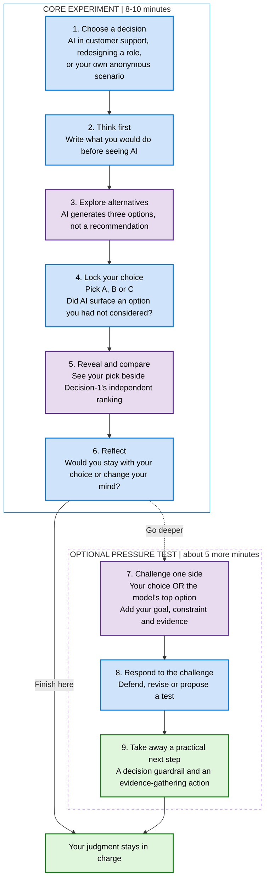

# The Decision Room: your experiment journey

**AI does not make the call. You do.**

Start with your own judgment, compare it with AI, then decide what deserves a second look.

**What to watch for:** Did AI expand your options? Did its ranking influence you? What evidence would justify changing your mind?

**Why this order matters:** You commit before seeing AI-generated options, and choose before seeing the model's ranking. Your selected option is not included in the independent scoring request. A model score is input to your judgment, not a verdict.
